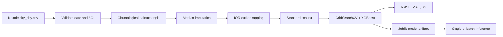

# Air Quality Index (AQI) Prediction

An end-to-end XGBoost regression project trained on observed city-day AQI and pollutant measurements from India's air quality monitoring data. It includes a Kaggle data downloader, leakage-aware chronological evaluation, a persisted preprocessing/model pipeline, and a single or batch prediction CLI.

## Data source and scope

Training uses `city_day.csv` from [Rohan Rao's Air Quality Data in India dataset on Kaggle](https://www.kaggle.com/datasets/rohanrao/air-quality-data-in-india), covering daily city-level observations from 2015 through 2020. The project's downloader fetches the public Kaggle archive and extracts this file when it is missing. The source has observed AQI labels and these six model inputs: PM2.5, PM10, NO2, SO2, CO, and O3. It does **not** include temperature or humidity, so the real-data model and CLI use pollutant readings only.

The raw Kaggle file is kept at `data/kaggle_city_day.csv`; it is not synthetic. Rows without an observed AQI, with unparseable dates, or with AQI outside 0–500 are excluded from supervised training. Pollutant missing values are handled by median imputation inside each training fold. The dataset is historical and should not be treated as a live feed or a guarantee of current city conditions.

The optional `data/generate_sample_data.py` script remains available for a small, reproducible synthetic CPCB-breakpoint dataset, but it is not the source used for model training.

## Architecture



## Modeling and evaluation

`XGBRegressor` is tuned with three-fold cross-validation over estimator count, tree depth, learning rate, and subsampling. The sklearn pipeline fits median imputation, IQR capping, and standard scaling only within each cross-validation/training fold. A chronological holdout uses the earliest 80% of distinct dates for training and later dates for testing, avoiding a random split that mixes future dates into training.

On the downloaded dataset used for this run, 24,307 rows remained after label filtering. The chronological cutoff was **2019-05-27**: 15,567 rows before the cutoff were used for training and 8,740 rows from the cutoff onward were held out for testing.

| Holdout metric | Result |
|---|---:|
| RMSE | 28.440 AQI points |
| MAE | 17.752 AQI points |
| R² | 0.8829 |

These measured-data benchmarks can vary with source revisions and library versions; use the metrics printed by your own run. The Kaggle target is observed AQI, so this measures prediction against recorded labels rather than a synthetic breakpoint formula. It is still an offline historical evaluation, not a prospective deployment guarantee.

## Setup

```bash
python -m venv .venv
# Windows: .venv\Scripts\activate
# macOS/Linux: source .venv/bin/activate
python -m pip install -r requirements.txt
```

## Download, train, and test

```bash
python data/download_kaggle_data.py
python src/train.py
```

Training downloads the Kaggle data automatically if `data/kaggle_city_day.csv` is absent. The selected model is saved to `models/aqi_xgboost_model.joblib`. The downloaded CSV is retained for reproducibility and is included by Git; model artifacts and the optional generated synthetic CSV are ignored.

## Inference

Predict a single observation (pollutant concentrations use the source dataset's units):

```bash
python src/predict.py
python src/predict.py --pm25 42 --pm10 91 --no2 38 --so2 12 --co 0.7 --o3 64
```

For batch prediction, provide a CSV containing these exact feature headers: `PM2.5`, `PM10`, `NO2`, `SO2`, `CO`, and `O3`.

```bash
python src/predict.py --input readings.csv
```

The CLI writes `<input>_predictions.csv` beside the input. Missing pollutant readings are median-imputed using statistics learned during training.

## Project layout

```text
data/       Kaggle downloader, real city-day data, optional synthetic generator
src/        preprocessing, training, and prediction modules
notebooks/  exploratory data analysis notebook
models/     saved model artifact location (artifact ignored)
```
